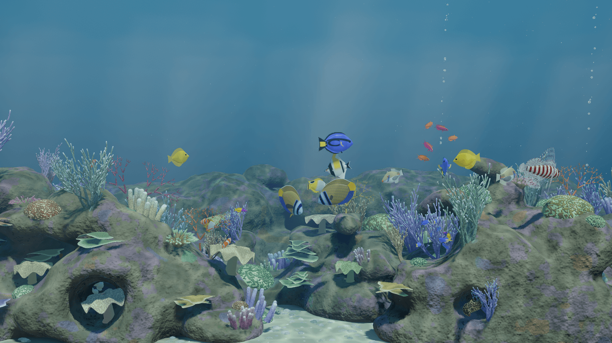
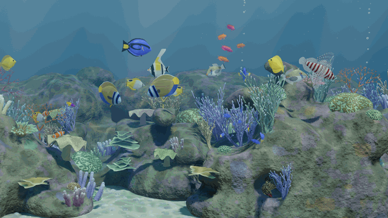
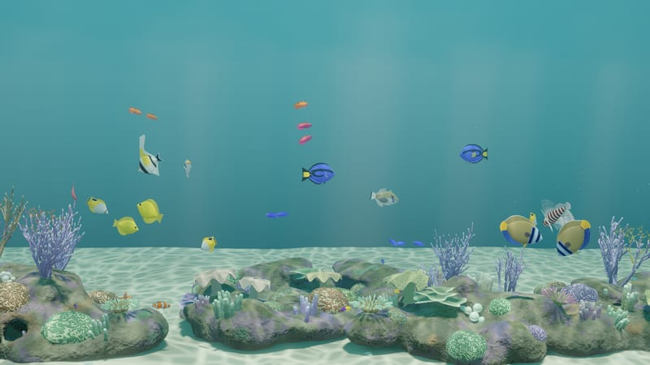
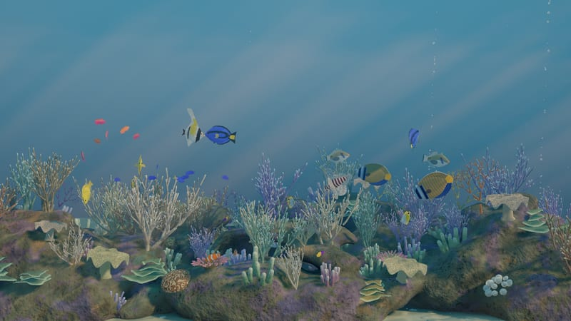
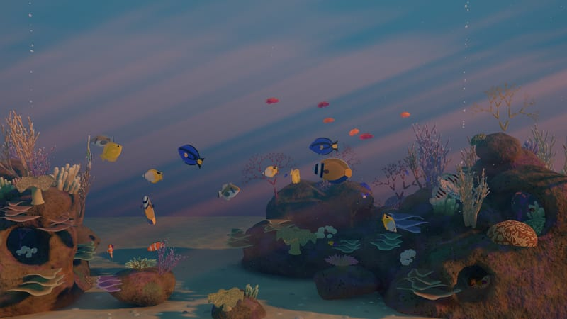
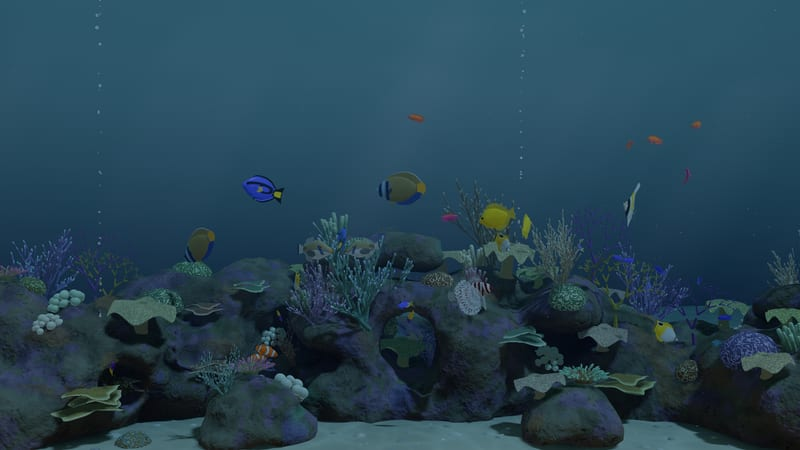
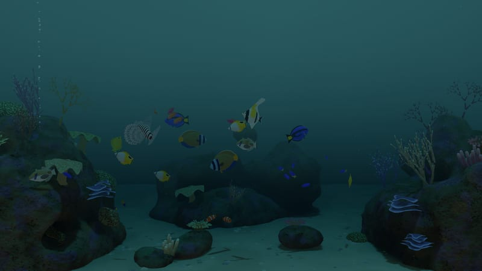
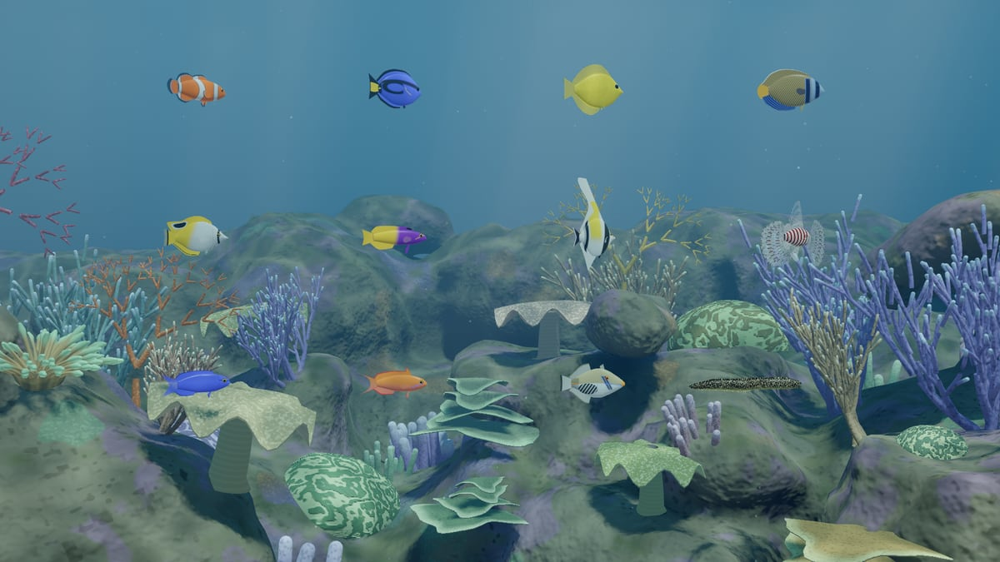

<h1 align="center">Reef Aquarium</h1>

<p align="center">
  <strong>A living reef aquarium rendered entirely in your browser.</strong><br>
  Twelve reef fish species that decide for themselves where to swim, procedural live rock and
  coral, six underwater scenes. Raw WebGPU, no game engine, one HTML file.
</p>

<p align="center">
  <a href="https://jfayling.github.io/fayling-web-fishtank-pictureframe/"><strong>▶ Try the live demo</strong></a>
  &nbsp;·&nbsp;
  <a href="#quick-start">Run it locally</a>
  &nbsp;·&nbsp;
  <a href="https://github.com/jfayling/fayling-web-fishtank-pictureframe/releases">Download the single-file build</a>
</p>

<p align="center">
  <a href="https://github.com/jfayling/fayling-web-fishtank-pictureframe/actions/workflows/ci.yml"></a>
  <a href="https://github.com/jfayling/fayling-web-fishtank-pictureframe/actions/workflows/pages.yml"></a>
  <a href="LICENSE"></a>
  
  
</p>

<p align="center">
  <a href="https://jfayling.github.io/fayling-web-fishtank-pictureframe/"></a>
</p>

<p align="center">
  <br>
  <sub>Six seconds captured from the running app at real speed. Nothing is keyframed: every fish is steering itself.</sub>
</p>

---

## Why it's different

- **No prerecorded animation.** Each fish runs its own state machine and steering. Its body
  wave, fin beats and banking come from how fast and how sharply it is swimming at that moment.
- **No game engine, no runtime dependencies.** About 7,500 lines of JavaScript and WGSL talk
  directly to the WebGPU API.
- **No asset files.** The rock, corals, sand, fish bodies, fins and color patterns are all
  generated at start-up from a seed.
- **One file.** `npm run build` produces a self-contained `aquarium.min.html` (about 220 KB)
  that runs straight from disk, from a USB stick, or on any static host.
- **Made for a wall.** It runs full screen and unattended indefinitely, hides the cursor when
  idle, and scales its own resolution to hold the frame rate on a monitor or TV.

## Features

What is implemented today:

| | |
| --- | --- |
| **Fish** | 12 species, 34 fish by default (configurable), each an independent agent |
| **Behavior** | Cruising, exploring, hovering, turning, avoiding, schooling, seeking shelter and resting states; obstacle probes into the reef; separation; territories |
| **Schooling** | Boids-style alignment and cohesion for the blue damselfish and lyretail anthias |
| **Reef** | Live rock with caves, swim-throughs, arches and overhangs; staghorn, brain, mushroom, plate, sea-fan, leather, bubble and finger corals and anemones; sand, stones and shell fragments |
| **Scenes** | Six lighting presets, five of them with their own rock and coral formation |
| **Lighting** | Sun shadows, projected caustics, half-resolution light shafts, depth-based absorption and fog, marine snow, bubbles |
| **Post** | 4× MSAA HDR, five-level bloom, AgX tone mapping, vignette, dithering |
| **Display** | Full screen on first click, idle cursor hiding, adaptive render scale, 30/60 FPS targets |
| **Extras** | Optional clock and weather widgets, ambient aquarium audio, background music, settings panel with share links |
| **Models** | Optional GLB/glTF import to replace any procedural species |

## Reef environments

Pick a scene from the toolbar, press `]` / `[`, or open the demo with `?scene=<id>`. Each
scene sets the water color and clarity, the sun's color and direction, caustics, light shafts
and current. Every scene except Day reef also builds its own rock and coral formation, the
first time it is shown.

| | | |
| :---: | :---: | :---: |
| <br>**Day reef** · `reef` | <br>**Lagoon** · `lagoon` | <br>**Morning** · `morning` |
| <br>**Sunset** · `sunset` | <br>**Moonlight** · `moonlight` | <br>**Deep water** · `deep` |

Try one directly: [Sunset](https://jfayling.github.io/fayling-web-fishtank-pictureframe/?scene=sunset) ·
[Lagoon](https://jfayling.github.io/fayling-web-fishtank-pictureframe/?scene=lagoon) ·
[Moonlight](https://jfayling.github.io/fayling-web-fishtank-pictureframe/?scene=moonlight)

## Fish species and autonomous behavior

<p align="center">
  <br>
  <sub>The built-in lineup view (<code>?view=lineup</code>), from top left: clownfish, blue tang, yellow tang, emperor angelfish · threadfin butterflyfish, royal gramma, Moorish idol, lionfish · blue damselfish, lyretail anthias, Picasso triggerfish, honeycomb moray.</sub>
</p>

| Species | What it does |
| --- | --- |
| Clownfish | Stays close to its anemone |
| Blue tang, yellow tang | Open-water cruisers with a carangiform tail beat |
| Emperor angelfish, threadfin butterflyfish, Moorish idol | Cruise and explore the reef at their own depths, pausing to hover or rest |
| Royal gramma | Keeps to ledges and overhangs |
| Lionfish | Hovers slowly, sculling with its fins |
| Blue damselfish, lyretail anthias | Swim in schools (alignment and cohesion) |
| Picasso triggerfish | Rows with its dorsal and anal fins (balistiform) |
| Honeycomb moray | Lives in its cave: extends out, looks around, breathes, retreats |

How a fish decides what to do:

- **State machine.** Each fish moves between eight behavior states. It changes state
  probabilistically, with weights and durations set per species.
- **Steering.** It sums its target, obstacle avoidance (probes into the rock and coral
  field), separation from neighbors, territory pull, the water current, and smooth individual
  wander.
- **Physical limits.** Heading turns at a limited rate, slower at low speed, so a fish slows
  and banks into a turn instead of flipping. A goal is kept only if open water lies straight
  to it, and a hard constraint keeps bodies out of the rock.
- **Individuality.** Size, preferred depth, speed, turn rate and personal space are varied
  per fish. Neighbor queries use a spatial hash.

Swimming is a vertex-shader body wave whose amplitude, frequency and wavelength depend on the
species and current speed. Styles include carangiform (tangs), labriform (wrasse-like pectoral
rowing), balistiform (triggerfish), the lionfish's slow sculling, and the moray's anguilliform
wave. Pectoral and median fins move independently, and fins are translucent.

## Quick start

**Just watch:** open the [live demo](https://jfayling.github.io/fayling-web-fishtank-pictureframe/)
in a [WebGPU browser](#browser-requirements). Click once to go full screen.

**Run from source:**

```sh
git clone https://github.com/jfayling/fayling-web-fishtank-pictureframe.git
cd fayling-web-fishtank-pictureframe
npm ci
npm start          # dev server on http://localhost:8080 (serves the ES modules directly)
```

**Build the standalone files:**

```sh
npm run build      # writes aquarium.html (readable) and aquarium.min.html (minified)
```

Both files are self-contained and can be opened by double-clicking them (`file://`). Keep
`media/track001.mp3` next to them if you want background music. More detail is in
[docs/BUILDING.md](docs/BUILDING.md).

**On a TV or picture frame:** open the page in Chrome or Edge on the attached computer, click
once for full screen, and leave it running. The page hides the cursor when idle, and adaptive
quality keeps the frame rate steady.

## Controls and configuration

| Key | Action |
| --- | --- |
| Click / any key | Go full screen |
| `F1` or `H` | Settings panel |
| `]` / `[` | Next / previous scene |
| `M` | Ambient aquarium sound on or off |
| `N` | Background music on or off |
| `T` / `F` | Show or hide the clock / weather |
| `Esc` | Close the panel or location search |

The **Settings** panel (dim toolbar, top right) has sections for general display options, the
tank, fish, effects, camera, sound and widgets. It also has Export, Import, Share link and
Reset. Changes apply immediately and are remembered in the browser. For a clean wall display,
turn off **General → Onscreen buttons**; `F1` still opens the panel.

Every tunable lives in [`js/config.js`](js/config.js) and can be overridden from the URL:

```text
?scene=sunset                          one visit of a named scene
?fish.population=60                    more fish
?fish.speedMultiplier=0.7              calmer fish
?effects.bubblesEnabled=false          no bubbles
?camera.movementEnabled=true           slow pan across the reef
?clock.enabled=false&weather.enabled=false   just the aquarium
?config=<base64url JSON>               a whole settings document
?info=1                                frame rate, resolution and GPU time readout
?view=lineup                           every species side by side
```

The clock and weather widgets are on by default. The weather card takes a city or a 5-digit
U.S. ZIP code (Settings → Widgets → Weather) and uses Open-Meteo and, for U.S. alerts, the
National Weather Service. These are the only network calls, and turning the widget off stops
them.

### Custom fish models

Set `assets.models` per species, for example `{ "blueTang": "models/blue-tang.glb" }` or
`{ "blueTang": { "url": "models/blue-tang.glb", "forward": "-z" } }`. The importer reads
meshes from the default scene (with node transforms), normals, UVs and the base-color texture.
It fits the model to the fish frame, and the procedural swimming deformation then drives it.
A model that fails to load falls back to the procedural fish. Draco and KTX2 need decoders
registered with `registerDecoder()` in `js/gltf.js`. None are bundled. Skeletal clips are
listed but not played.

## WebGPU technical architecture

```text
config.js ─► settings.js ─┐
scenes.js ────────────────┤
                          ▼
reef.js (rock SDF → surface nets, AO, coral placement, obstacle field)
coral-mesh.js · species.js · fish-mesh.js        (CPU, once per formation)
                          │
behavior.js  Aquarium simulation ──► per-species instance buffers (every frame)
                          │
main.js  frame graph:
  caustics bake (1024²) → shadow map (static casters once, fish + soft coral every other frame)
  → 4× MSAA HDR forward pass: rock, sand, coral, fish, background, bubbles, particles
  → light shafts (½ res, upsampled) → bloom (5 levels) → AgX composite → swap chain
```

| Module | Role |
| --- | --- |
| [`js/reef.js`](js/reef.js) | Live rock as a metaball density field with domain warp and carved tunnels (moray cave, swim-throughs, arch, overhang), meshed with surface nets; baked AO; sand heightfield; coral placement; the obstacle field the fish steer by |
| [`js/coral-mesh.js`](js/coral-mesh.js) | Staghorn, brain, mushroom, plate, sea fan, leather, bubble, anemone and finger coral; stones and shell fragments |
| [`js/species.js`](js/species.js) | Per-species anatomy (body profiles, fins, eyes), swimming style and behavior parameters |
| [`js/fish-mesh.js`](js/fish-mesh.js) | Lofted bodies with separate caudal, dorsal, anal, pectoral and pelvic fin membranes, domed eyes and a hinged moray jaw |
| [`js/behavior.js`](js/behavior.js) | `FishEntity` and the `Aquarium` simulation: state machine, steering, spatial hash, collision constraints |
| [`js/wgsl/`](js/wgsl) | Fish deformation and color patterns, rock/sand/coral materials, caustics, shadows, water absorption and fog, particles, bubbles, light shafts, bloom, tone mapping |
| [`js/scenes.js`](js/scenes.js) | Named scenes: water, sun, and which formation to build |
| [`js/main.js`](js/main.js) | WebGPU device, pipelines, render passes, frame loop, adaptive quality |
| [`js/settings.js`](js/settings.js), [`js/clock.js`](js/clock.js), [`js/weather.js`](js/weather.js), [`js/place.js`](js/place.js) | Settings panel and persistence, overlay widgets, location lookup |
| [`js/audio.js`](js/audio.js), [`js/music.js`](js/music.js) | Procedural bubble and hiss audio (Web Audio), looping soundtrack |
| [`js/gltf.js`](js/gltf.js) | GLB/glTF import for replacing procedural fish |
| [`build.mjs`](build.mjs) | Bundles everything into one HTML file; minifies WGSL and JS |

## Performance characteristics

- **Per frame:** no allocations. Fish and corals are instanced, one draw per species and per
  coral mesh. The simulation runs on the CPU in a fraction of a millisecond.
- **Frame-rate target:** 60 FPS. If frames run long, the render scale steps down to
  `display.minRenderScale`, then the target drops to 30 FPS. The render scale climbs back
  when there is headroom again.
- **Built-in measurement:** `?info=1` shows frame rate, resolution, render scale and, where
  the device supports timestamp queries, GPU frame time.
- **One measured data point:** at 1920×1080 on an NVIDIA RTX A5000 (Chrome, Windows, headless
  capture), GPU time was 7.2 ms per frame for Day reef and 10.6 ms for Lagoon. Building a reef
  formation took 0.3–0.6 s at start-up. Other hardware has not been benchmarked yet, and
  [reports are welcome](https://github.com/jfayling/fayling-web-fishtank-pictureframe/issues/new?template=bug_report.yml).

## Browser requirements

WebGPU is required; there is no WebGL fallback.

| Browser | Status |
| --- | --- |
| Chrome / Edge 113+ on Windows, macOS, ChromeOS | Supported. Developed and tested in Chrome on Windows |
| Chrome 121+ on Android | Expected to work on recent devices; not yet tested |
| Safari 26+ (macOS, iOS, iPadOS) | Expected to work; not yet tested |
| Firefox 141+ on Windows | Expected to work; not yet tested |
| Chrome on Linux | May need `chrome://flags/#enable-unsafe-webgpu` |

Without WebGPU, the page explains what is missing instead of showing a black screen. See
[docs/BROWSER_SUPPORT.md](docs/BROWSER_SUPPORT.md) and
[docs/TROUBLESHOOTING.md](docs/TROUBLESHOOTING.md).

## Contributing

Contributions are welcome. [CONTRIBUTING.md](CONTRIBUTING.md) explains how the code is laid
out, how to run the visual checks, and what CI expects. Some directions that would make great
contributions (none of these exist yet):

- **New species:** a new entry in `js/species.js` with its anatomy, swimming style and
  behavior.
- **New reef formations:** rock massifs, tunnels and coral mixes in `js/reef.js`.
- **Behavior:** feeding, cleaner-fish interactions, day/night routines, predator awareness.
- **Rendering:** cheaper shadows, GPU-side simulation, better mobile scaling.
- **Accessibility:** a reduced-motion mode, keyboard-only settings polish, screen-reader
  descriptions.

## Living Frames: related projects

This aquarium is one of three open-source, GPU-powered digital displays designed to run full
screen on a monitor, TV or picture frame. Each is a self-contained web page with no game
engine, and none needs the others or any external website.

- **[fayling-web-ocean-pictureframe](https://github.com/jfayling/fayling-web-ocean-pictureframe):**
  a real-time WebGPU ocean with simulated waves, a sky driven by your location, procedural surf
  sound, and live weather.
- **[fayling-web-scenery-pictureframe](https://github.com/jfayling/fayling-web-scenery-pictureframe):**
  a real-time WebGPU aerial screensaver. An autonomous camera flies over procedural forests,
  mountains, rivers, coasts and canyons, and then over measured lunar terrain.
- **fayling-web-fishtank-pictureframe:** this reef aquarium.

## License and attribution

The code is released under the [MIT License](LICENSE).

- Parts of the build tooling, dev server, bloom and composite shaders, and WebGPU frame setup
  are adapted from
  [fayling-web-ocean-pictureframe](https://github.com/jfayling/fayling-web-ocean-pictureframe),
  whose renderer was written by Maksymilian Dendura. His MIT copyright notice is kept in
  [LICENSE](LICENSE).
- The AgX tone-mapping fit follows Benjamin Wrensch's minimal implementation of Troy Sobotka's
  AgX.
- **`media/track001.mp3` is not covered by the MIT License.** It is a Suno-generated track
  governed by Suno's terms.
- Weather data comes from [Open-Meteo](https://open-meteo.com) (CC BY 4.0) and the U.S.
  National Weather Service.

Full details, including open questions, are in [NOTICE.md](NOTICE.md).
