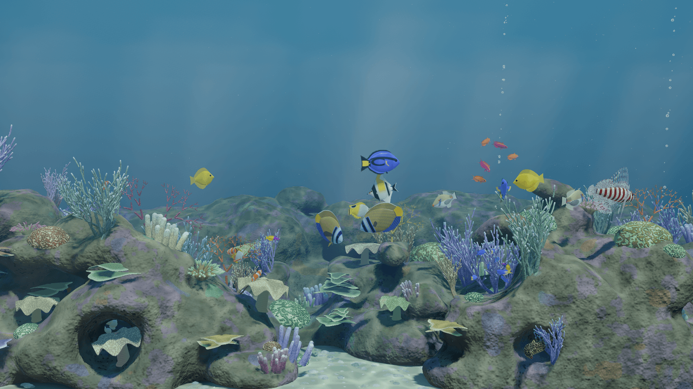

# Reef Aquarium v1.0.0

The first public release: a living reef aquarium rendered entirely in your browser, in raw
WebGPU with no game engine.

**▶ [Live demo](https://jfayling.github.io/fayling-web-fishtank-pictureframe/)**

## Highlights

- **12 reef fish species, 34 fish by default.** Each fish is an independent agent with its own
  state machine: cruising, exploring, hovering, turning, avoiding, schooling, seeking shelter
  and resting. Steering combines targets, obstacle probes into the reef, separation,
  territories and the water current.
- **Schooling** (alignment and cohesion) for blue damselfish and lyretail anthias. Clownfish
  keep to their anemones, royal grammas to ledges, and the honeycomb moray to its cave.
- **No prerecorded animation.** Swimming is a vertex-shader body wave per species and speed,
  with independent fin motion, banking and translucent fins.
- **Procedural reef.** Live rock with caves, swim-throughs, arches and overhangs (metaball
  field, surface nets, baked AO); staghorn, brain, mushroom, plate, sea-fan, leather, bubble
  and finger corals and anemones that sway in the current.
- **Six scenes:** Day reef, Lagoon, Morning, Sunset, Moonlight and Deep water. Five of them
  have their own rock and coral formation.
- **Underwater lighting:** sun shadows, caustics, light shafts, absorption and fog, marine
  snow, bubbles, bloom and AgX tone mapping, with 4× MSAA HDR.
- **Made for a wall display:** full screen on first click, idle cursor hiding, and adaptive
  render scale and frame rate for TVs and monitors.
- **Settings panel** with share links, import and export; optional clock and weather widgets,
  ambient audio and background music.
- **Optional glTF/GLB models** can replace any procedural species and keep the procedural
  swimming.

## Standalone HTML

Download **`aquarium.min.html`** (about 220 KB) from the assets below and double-click it. It
is the whole aquarium in one file: no install, no server, no network needed. `aquarium.html`
is the same build, unminified and readable.

For background music, also download **`aquarium-v1.0.0.zip`**, which has the HTML files and
`media/track001.mp3` in the right layout. Without the music file the aquarium runs silently.

## Supported browsers

WebGPU is required.

- Chrome / Edge 113+ on Windows, macOS and ChromeOS (tested in Chrome on Windows)
- Expected to work but not yet tested: Chrome 121+ on Android, Safari 26+, Firefox 141+ on
  Windows
- Chrome on Linux may need `chrome://flags/#enable-unsafe-webgpu`

Without WebGPU, the page explains what is missing. See
[Browser support](https://github.com/jfayling/fayling-web-fishtank-pictureframe/blob/main/docs/BROWSER_SUPPORT.md).

## Known limitations

- No WebGL fallback; browsers without WebGPU cannot run it.
- Only tested on desktop Chrome (Windows, NVIDIA). Mobile, Safari and Firefox reports are
  welcome.
- The camera is fixed by default (an optional slow pan is in Settings → Camera); there is no
  free camera.
- Imported glTF models: Draco and KTX2 need user-registered decoders, skeletal animation clips
  are not played, and fins animate with the body only.
- The weather widget needs network access (Open-Meteo, plus the U.S. National Weather Service
  for alerts) and is on by default; turn it off with `F` or `?weather.enabled=false`.
- Audio starts only after a click or key press (browser autoplay rules).
- `media/track001.mp3` is not covered by the MIT License; see
  [NOTICE.md](https://github.com/jfayling/fayling-web-fishtank-pictureframe/blob/main/NOTICE.md).

## Also in this release

- GitHub Pages deployment and CI that rebuild and validate the standalone files.
- Clear error messages when WebGPU, a secure page or a GPU adapter is unavailable. Previously
  a browser without WebGPU stayed on the loading screen.
- Contributor docs: CONTRIBUTING, build, browser support and troubleshooting guides, and issue
  and pull request templates.

Part of **Living Frames**, with
[fayling-web-ocean-pictureframe](https://github.com/jfayling/fayling-web-ocean-pictureframe) and
[fayling-web-scenery-pictureframe](https://github.com/jfayling/fayling-web-scenery-pictureframe).
